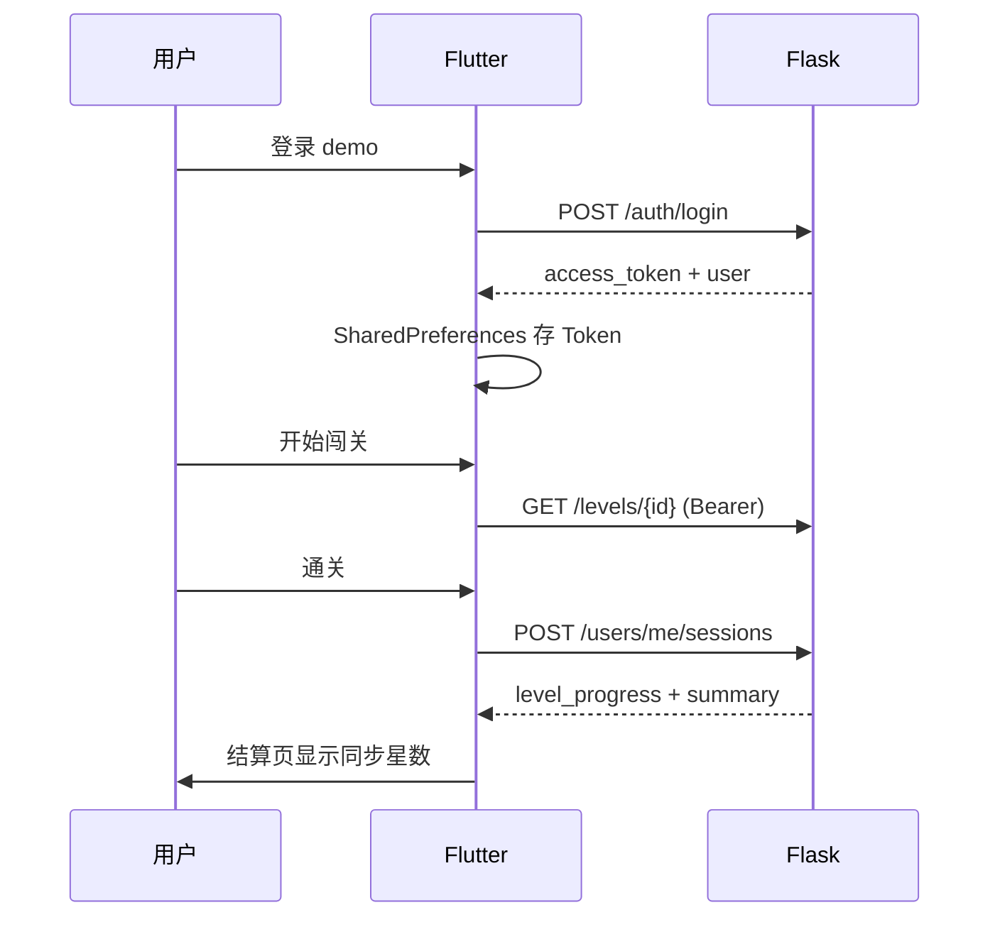

# 账号体系

> 打通登录、进度同步、manifest 个性化、对局上报与链路追踪。

## 能力矩阵

| 体系 | 登录前 | 登录后 |
|------|--------|--------|
| 内容 manifest | 公开拉取 | 响应内嵌 `user.summary` |
| 关卡加载 | 本地/远程 | 同左 |
| 对局结算 | 仅本地展示 | `POST /users/me/sessions` 上报 |
| 进度/三星 | 不保存 | `GET /users/me/progress` |
| 链路追踪 | `X-Trace-Id` | + 服务端日志 `user_id` |
| 首页 | 匿名试玩 | 账号卡片 + 关卡历史星数 |

## 体验账号

- 用户名：`demo`
- 密码：`demo123456`

后端首次启动会自动创建该账号。

## API

| 方法 | 路径 | 说明 |
|------|------|------|
| POST | `/api/v1/auth/register` | 注册 |
| POST | `/api/v1/auth/login` | 登录，返回 JWT |
| GET | `/api/v1/auth/me` | 当前用户（需 Bearer） |
| GET | `/api/v1/users/me/progress` | 关卡进度 |
| POST | `/api/v1/users/me/sessions` | 上报单局结果 |
| GET | `/api/v1/content/manifest` | 可选 Bearer，返回用户摘要 |

契约见 `shared/auth/auth_schema.json`。

## 客户端流程



## 本地存储

- Token / 用户名：`SharedPreferences`
- 关卡缓存：`meme_cache/levels/`（与账号无关）

## 开发命令

```bash
# 后端
cd backend && pip install -r requirements.txt
PYTHONPATH=. pytest -q

# 客户端
cd app && flutter pub get && flutter test
```

## 后续扩展

- [ ] 微信/手机号 OAuth
- [ ] 赛季榜与用户 ID 绑定
- [ ] 变现钩子记录与频控
- [ ] PostgreSQL 替换 JSON 文件存储
