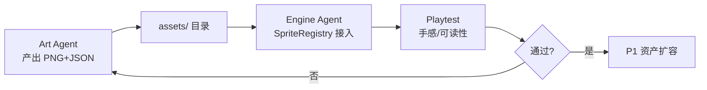

# 美术资产智能体（Art Agent）规范

## 1. 定位与边界

| 角色 | 职责 | 禁止越界 |
|------|------|----------|
| **Art Agent** | 视觉方向、像素资产生产、精灵表 JSON、交付检查 | 不写游戏逻辑、不改 API |
| **Engine Agent** | Flame 渲染接入、动画状态机、资源加载 | 不决定视觉风格 |
| **Content Agent** | 关卡 JSON、梗包 manifest、热更 | 不制作贴图 |

三者通过 **`shared/art/` 契约 + `assets/` 目录** 并行协作，互不阻塞。

---

## 2. 并行工作流（Loop）



### 单轮迭代 Checklist

**Art Agent 交付：**
- [ ] PNG 精灵表（RGBA，无抗锯齿）
- [ ] 同名 `.json` 元数据（帧数、fps、anchor、animations）
- [ ] 更新 `shared/art/asset_manifest.json` 版本号
- [ ] 通过 `scripts/validate_art_assets.py`

**Engine Agent 交付：**
- [ ] `SpriteRegistry` 注册新资源
- [ ] 组件从色块 fallback 切到 sprite（保留 fallback）
- [ ] `flutter test` + 目视试玩

---

## 3. 目录结构

```
app/assets/
├── images/sprites/          # Flame 默认前缀 assets/images/
│   ├── player/
│   ├── environment/
│   ├── collectibles/
│   └── enemies/
├── ui/                      # Flutter Widget 层
├── backgrounds/
├── particles/
└── fonts/

shared/art/
├── asset_manifest.json      # 全局资产清单与版本
├── palette.json             # 调色板约束
└── delivery_schema.json     # 精灵表 JSON Schema

docs/
├── art-direction.md         # 视觉支柱（详细）
└── art-agent.md             # 本文档

scripts/
├── generate_p0_sprites.py   # P0 程序化像素资产生成
└── validate_art_assets.py   # 交付校验
```

---

## 4. Art Agent Prompt 模板（可复用）

```
你是「搞事事」像素闯关游戏的美术智能体。

约束：
- Tile 32px，玩家 28x28，金币 20x20，nearest neighbor
- 调色板见 shared/art/palette.json，禁止越界色
- 梗风：离谱但可爱，1px #1A1A1A 描边
- 交付：PNG + 同名 JSON + 更新 asset_manifest.json

当前任务：[P0/P1/P2] [资产ID] [描述]
参考：docs/art-direction.md
输出路径：app/assets/images/sprites/...
```

---

## 5. 优先级队列

| 批次 | 资产 | 负责 Agent | 状态 |
|------|------|-----------|------|
| P0 | player/coin/tile/goal | Art + Engine | 🔄 进行中 |
| P1 | 敌人、粒子、结算横幅、梗气泡 | Art | 待启动 |
| P2 | 梗皮肤 doge/wojak、彩虹平台 | Art | 待启动 |

---

## 6. 与代码对接

Engine 侧统一通过 `SpriteRegistry` 加载：

```dart
final anim = registry.getAnimation('player', 'run');
```

资源路径、帧参数全部来自 JSON，Art Agent 改 JSON 即可调动画，无需改 Dart 逻辑。

详见 `app/lib/core/engine/sprites/sprite_registry.dart`。
