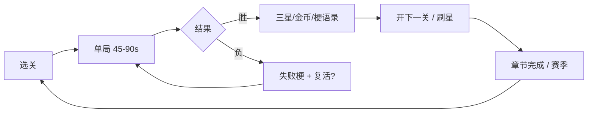
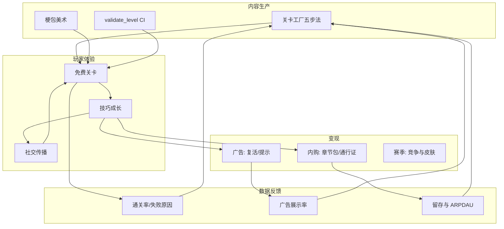

# 交互策划手册：可玩性 · 盈利 · 玩家生态 · 商业闭环

> 读者：游戏交互策划（可兼数值/商业化）  
> 前提：关卡量产体系见 [level-production.md](./level-production.md)，引擎为横版梗游「搞事事」

## 一、策划职责边界

| 你负责 | 你不负责（其他角色） |
|---|---|
| 单局节奏、失败原因、复活时机 | 像素美术绘制 |
| 三星目标与章节难度曲线 | 服务端架构 |
| 变现钩子开关与展示文案 | 底层碰撞代码 |
| 赛季/排行榜规则 | 梗合规终审（法务/运营） |
| 玩家留存与社交传播动机 | |

**工作流**：选原型 → 调旋钮 → 填 monetization_hooks → 试玩 → 看数据 → 迭代。

---

## 二、五种原型的可玩性设计

### 1. rush_standard（标准冲关）

- **玩家心理**：熟悉感、成就感、收集欲
- **节奏**：前 1/3 教学 → 中 1/3 障碍 → 后 1/3 冲刺
- **失败设计**：掉落、侧面碰敌；失败可理解、可复盘
- **三星梯度**：通关 → 60% 金币 → 清敌
- **适合章节**：每章第 1 关，降低学习成本

### 2. timed_rush（限时冲关）

- **玩家心理**：紧迫感、竞速、重玩刷星
- **节奏**：开局即压迫；短路高风险高收益
- **失败设计**：超时；最后 15 秒 HUD 变红（已实现）
- **三星梯度**：通关 → 60s → 45s（可随章节收紧）
- **留存钩子**：赛季最快通关榜、好友 PK
- **变现**：`revive_on_fail`（超时前 3 秒触发最佳）、`hint_reveal`（捷径提示）

### 3. reversal_trap（反转陷阱）

- **玩家心理**：好奇 → 被骗 → 顿悟 → 分享
- **节奏**：假旗早出现；真终点需绕路或跳层
- **失败设计**：碰假旗；文案梗化（「假旗也敢冲？」）
- **三星梯度**：通关 → 无伤 → 全金币（鼓励探索真路）
- **传播点**：首见假旗的「反转」适合短视频切片
- **变现**：`hint_reveal`（看广告标真旗方向，不强推）

### 4. greed_tax（来财税局）

- **玩家心理**：贪婪 vs 恐惧；「要不要多拿两币」
- **节奏**：金币密集区 = 敌人加速区
- **失败设计**：贪太多跑不过巡逻；非操作失误而是决策失误
- **三星梯度**：通关 → 50% 币 → 100% 币（三星极难，二星舒适）
- **变现**：`double_coins`（通关）、`skip_hard_section`（税区跳过）
- **引擎状态**：机制 P2；策划可先摆关 + 写 tip，数值用表预埋

### 5. lie_flat（躺平计量）

- **玩家心理**：反内卷共鸣；走停走停的节奏谜题
- **节奏**：长平台鼓励停；窄道必须短冲
- **失败设计**：面子归零；区别于「掉落」的软性失败
- **三星梯度**：通关 → 90s 内 → 无伤（停得多则不易无伤，需权衡）
- **变现**：`revive_on_fail`（面子耗尽）；未来可加「面子补给」内购
- **引擎状态**：机制 P2；策划先定 `drain/recover` 表

---

## 三、章节难度曲线（模板）

| 章节位置 | 推荐原型组合 | 难度 | 单局时长目标 |
|---|---|---|---|
| 1-1 ~ 1-3 | rush → timed → reversal | easy ~ normal | 60–90s |
| 1-4 ~ 1-6 | rush + greed + lie_flat | normal | 75–100s |
| 2-x 起 | 五原型混排，每章至少 3 种 | normal ~ hard | 60–120s |
| 挑战/赛季 | timed_rush 为主 | hard ~ chaos | 30–60s 刷星 |

**原则**：每章引入 **1 个新机制或新梗皮**，不叠两个新东西。

---

## 四、盈利策略（策划填表）

### 4.1 变现槽位与玩家意图

| 槽位 | 玩家意图 | 展示时机 | 频控建议 |
|---|---|---|---|
| `revive_on_fail` | 「就差一点」 | 失败页 0.5s 内 | 每关最多 1 次 |
| `double_coins` | 「多捞点」 | 胜利结算 | 每日前 3 次免费加成 |
| `hint_reveal` | 「不想试错」 | 反转关失败 2 次后 | 每关 1 次 |
| `skip_hard_section` | 「税区太难」 | 贪税关死亡于税区 | 章节限 2 次 |
| `season_bonus` | 「冲榜」 | 限时关破纪录 | 赛季周期重置 |

在关卡 JSON 中只写 `enabled: true/false`；具体广告/内购 SKU 由商业化配置表映射。

### 4.2 付费与非付费平衡

- **非付费路径**：任何关可纯技巧通关；三星不要求看广告
- **付费加速**：复活、双倍币、跳过段 — 省时间，不锁内容
- **禁忌**：假旗关强制看广告才告知真路；限时关暗中减秒

### 4.3 章节与礼包（闭环）

```
免费章节 1–3（教学 + 五原型各体验）
    ↓
章节 4+ 体力 / 章节包（梗包 DLC）
    ↓
赛季通行证（限时皮肤 + 关卡 + 双倍币加成）
    ↓
UGC/梗投稿榜（传播 → 回流）
```

---

## 五、玩家生态

### 5.1 核心循环



### 5.2 社交与传播

| 触点 | 设计 |
|---|---|
| 结算梗语录 | 可截图分享（已实现随机语录） |
| 反转关 | 「你也被假旗骗了吗」话题 |
| 限时榜 | 周榜重置 + 称号 |
| 躺平关 | 共鸣向梗，适合社区 meme |

### 5.3 留存

- **日活**：每日 1 关限时挑战（固定 `timed_rush` 变体）
- **周活**：章节三星总和奖励
- **回流**：新梗包 push + 新 `meme_theme` 关卡

---

## 六、商业闭环总图



**闭环关键**：`D1 失败原因` 按 `archetype` 分桶 — 例如 timed 关超时率 >40% 则下版加秒或标捷径。

---

## 七、策划日常检查清单

### 新关提交前

- [ ] `python scripts/validate_level.py` 通过
- [ ] `tip_text` 说清本关核心规则（≤120 字）
- [ ] `monetization_hooks` 与本关失败原因匹配
- [ ] `star_rules` 二星可达、三星可肝
- [ ] 试玩 3 次：新手路径 / 贪路线 / 速通路线

### 章节发布前

- [ ] 章内 ≥3 种 archetype
- [ ] 难度单调递增，无突然 spike
- [ ] 变现总频次不超过「每 10 分钟 3 次广告机会」
- [ ] 梗主题合规自查

### 赛季调优

- [ ] 限时关池每周轮换 `level_id`
- [ ] 根据 `timeUp` / `fakeGoal` / `hitByEnemy` 占比调参
- [ ] 通行证奖励与赛季主题 `meme_theme` 一致

---

## 八、与工程对接

| 策划产出 | 工程接入点 |
|---|---|
| 关卡 JSON | `app/assets/levels/` + `backend/app/data/levels/` |
| 新原型 | `shared/level/archetypes/` + `ArchetypeRegistry` |
| 新机制 | `MechanicType` + 引擎 `MemePlatformerGame` |
| 新变现槽 | `MonetizationSlot` + 结算页 UI |
| 远程开关 | 后续 manifest `monetization_config` |

---

## 九、示例：交互策划一天工作流

1. **上午**：从 `templates/timed_rush.template.json` 复制 3 关，改 `meme_theme` 为职场梗
2. **下午**：调 `seconds` / 敌人巡逻，本地 `/gameplay?levelId=xxx` 试玩
3. **提交**：跑校验脚本，PR 附通关录像与三星说明
4. **复盘**：看 trace 日志里 `game.session.ended` 的 `reason` 分布

---

## 十、附录：失败原因与策划动作

| reason | 玩家感受 | 策划动作 |
|---|---|---|
| `fellOff` | 操作失误 | 检查平台宽度与跳跃距离 |
| `hitByEnemy` | 战斗失误 | 调整巡逻范围或加教学提示 |
| `timeUp` | 时间不够 | 加秒或标捷径 |
| `fakeGoal` | 被骗 | 确保假旗可见性合理，2 次失败后开 hint |

详细验收项见 [acceptance-test.md](./acceptance-test.md)。
